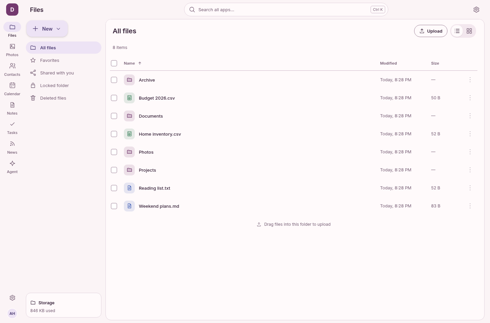
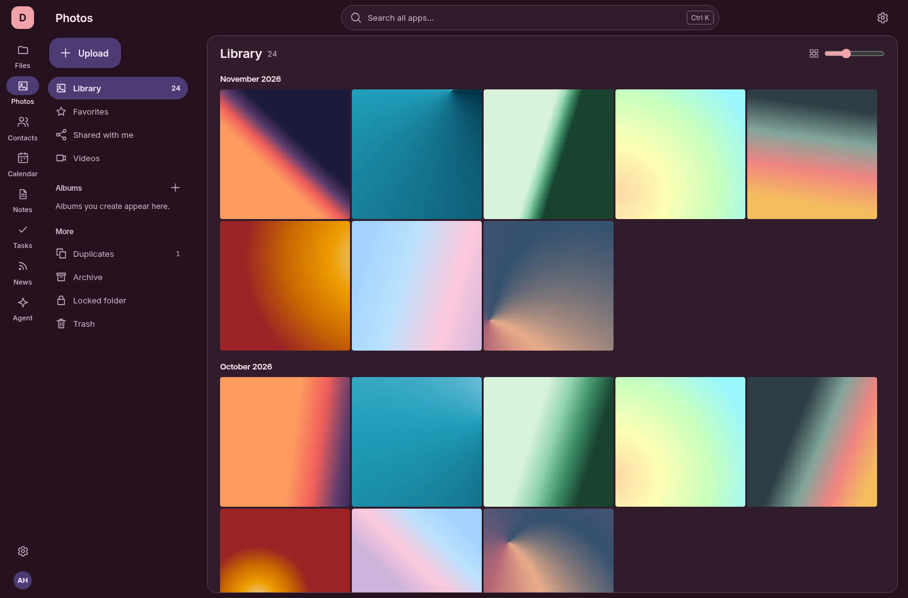
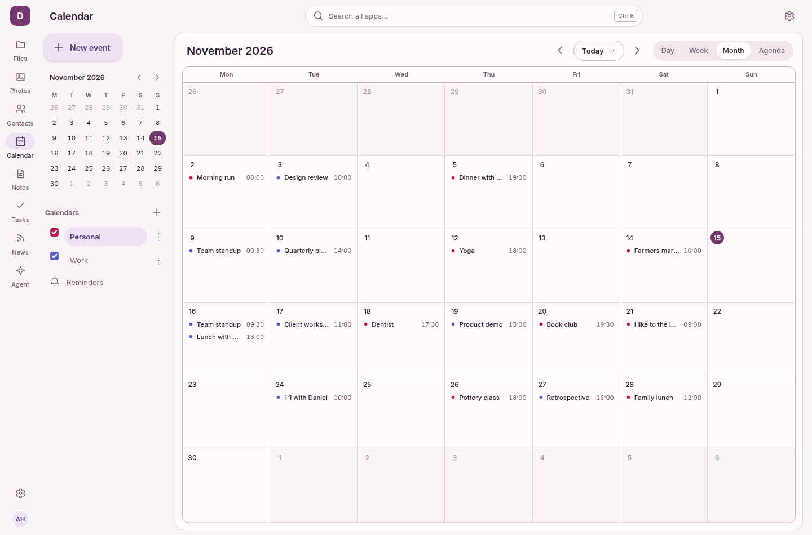
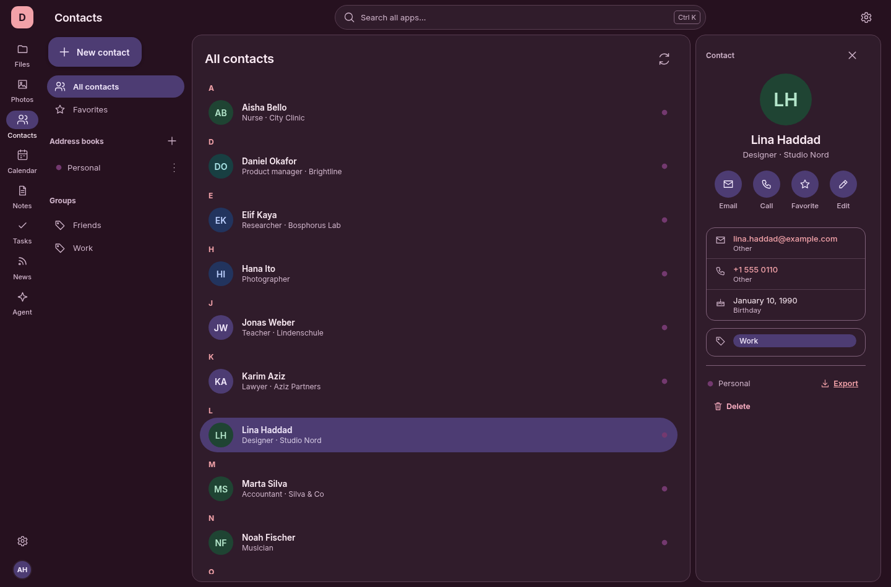
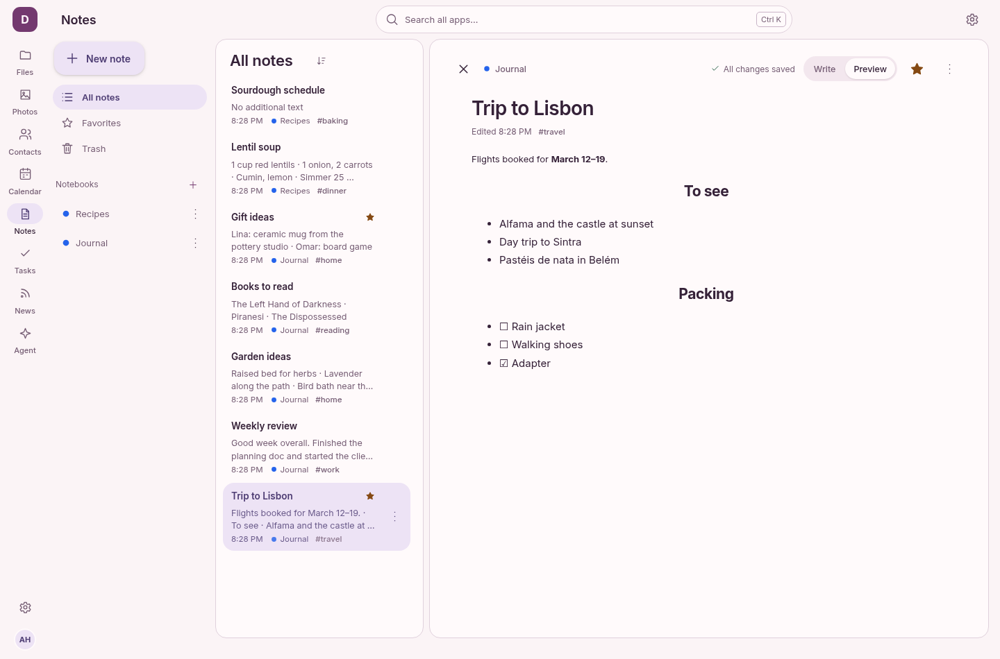
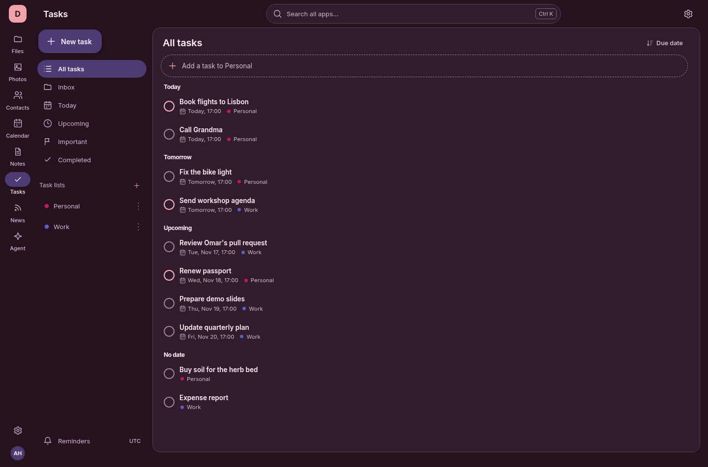
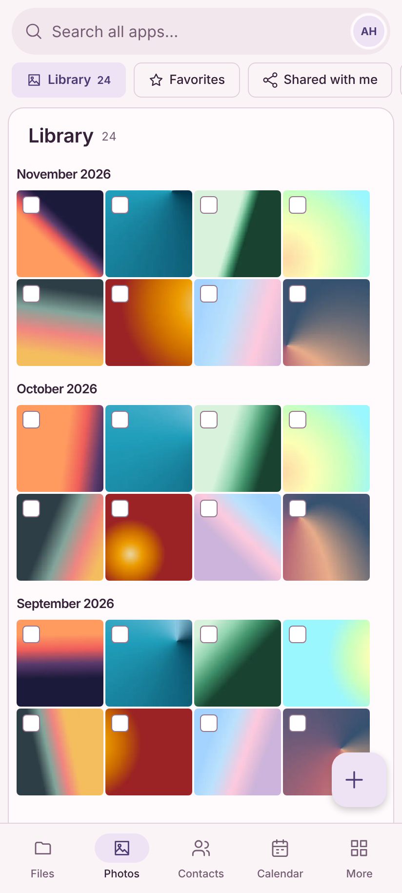
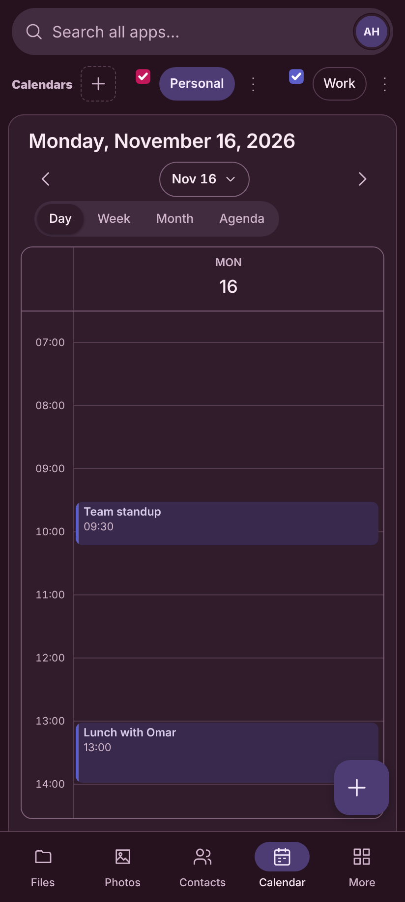

# Dar

A self-hosted personal cloud for Linux: Files, Contacts, Calendar, Notes, Tasks,
an Agent, and installable apps such as Prayer Times. Dar also
provides OIDC sign-in and SCIM provisioning for other applications.

## Screenshots

| Files · light | Photos · dark |
| --- | --- |
|  |  |

| Calendar · light | Contacts · dark |
| --- | --- |
|  |  |

| Notes · light | Tasks · dark |
| --- | --- |
|  |  |

| Phone · Photos | Phone · Calendar |
| --- | --- |
|  |  |

## Run locally

```sh
nix develop
npm ci
cargo xtask dev
```

Open <http://127.0.0.1:4331>. `cargo xtask dev` builds the stack, keeps its data in
`~/.local/share/dar-rust` and prints the path to the private setup key used to create the
first account. An existing instance's data folder and database are taken over in place
(see `docs/porting.md`).

## Deploy

`nix build .#dar` and the NixOS module; see the [deployment guide](docs/deployment.md).

## Develop

Dar is written in Rust: one Cargo workspace with the SpacetimeDB module, the runtime and
the Leptos client in `crates/`, the acceptance suite in `tests/` and the build commands in
`xtask/`; the chat bridge is in Go (`bridge/`) and the installed-app SDK in JavaScript
(`sdk/`). Run all checks with `nix develop --command cargo xtask verify` ([testing](docs/testing.md)). UI work
follows the [design guide](docs/design.md); engineering rules are in `AGENTS.md`.
