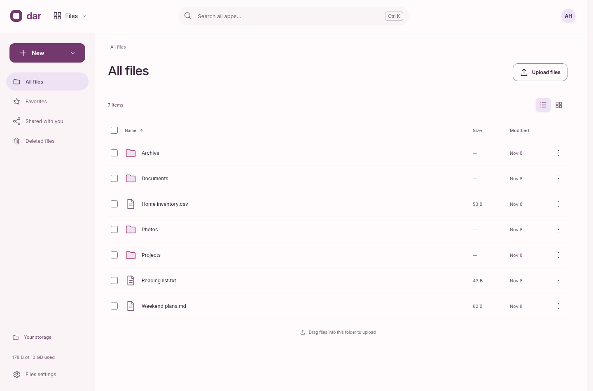
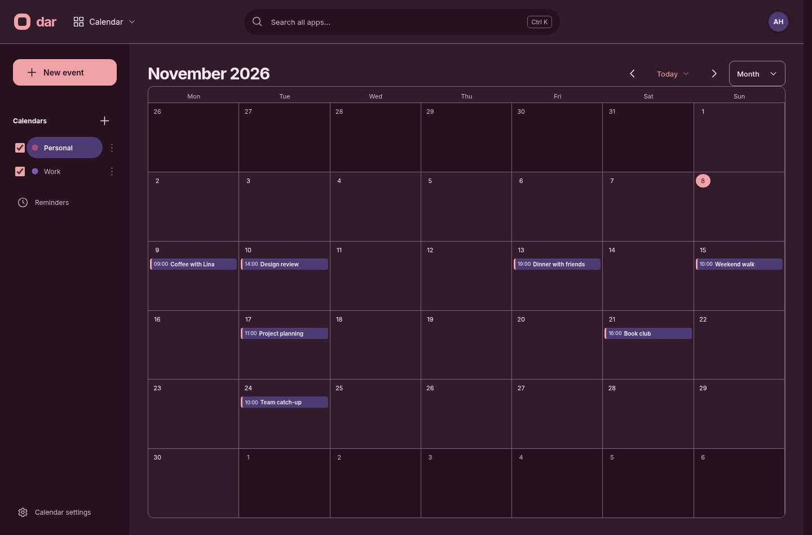
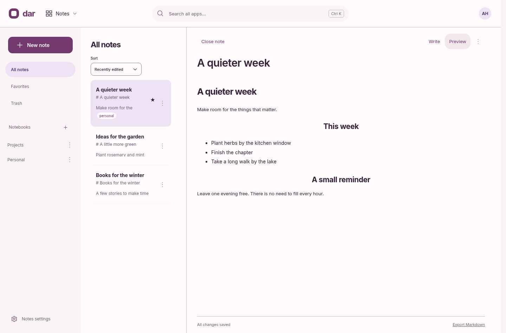
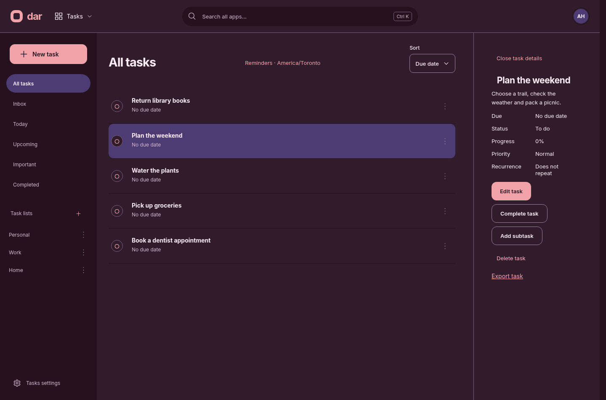

# Dar

A self-hosted personal cloud for Linux: Files, Contacts, Calendar, Notes, Tasks,
an optional coding Agent, and installable apps such as Prayer Times. Dar also
provides OIDC sign-in and SCIM provisioning for other applications.

## Screenshots

| Files · light | Calendar · dark |
| --- | --- |
|  |  |

| Notes · light | Tasks · dark |
| --- | --- |
|  |  |

## Run locally

```sh
nix develop
npm ci --prefix next
npm --prefix next run dev
```

Open <http://127.0.0.1:4311>. The dev script prints the path to the private setup
key used to create the first account.

## Deploy

`nix build .#dar` and the NixOS module; see the [deployment guide](docs/deployment.md).

## Develop

The application is in `next/` ([guide](next/README.md)). Run all checks with
`nix develop --command npm --prefix next run verify`. UI work follows the
[design guide](docs/design.md).
