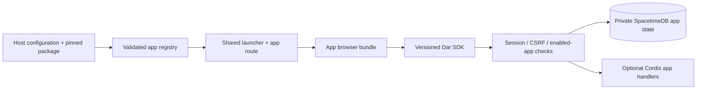

# Installable apps and Prayer Times

Status: implemented architecture and delivery contract, November 8, 2026.
The maintainer selected **trusted administrator-installed apps**, layout B and
Dar's own calculation library, then authorized implementation. Prayer Times is a
separately built/installed package exercising the public SDK; no calculation
dependency was added. See [installation and supported limits](../apps.md).

The maintainer selected [Prayer Times layout B](prayer-times-mocks.html): a week
list with a focused daily timetable. On phones, opening a day shows a full-width
timetable with an explicit return to the week. Static mocks were checked in
Chromium at 728px and 390px with no horizontal overflow.

## Direction

Hosts install a built app package, restart Dar, and find it in the shared launcher.
Authors develop in their own repository against a versioned TypeScript SDK. They
do not edit Dar's router, client entry point, database module, or preference schema.
Start with local packages and reproducible Nix installation; a marketplace and
automatic downloads can follow after the extension contract has real users.

These are Dar apps. Nextcloud's PHP apps are not binary or source compatible.
Its manifest/compatibility model is a useful precedent, not an API to emulate.

Installed Node and same-origin browser code is trusted as part of Dar. It can
compromise the instance or act with a user's browser authority. SDK permissions
prevent mistakes and constrain supported integrations; they are **not a sandbox**.
Do not market manifest declarations as isolation from malicious installed code.

## What exists and what must change

| Current code | Change |
| --- | --- |
| `next/client/apps.tsx`, `main.tsx`: closed IDs, launcher and routes | Merge built-in descriptors with authenticated installed-app discovery; preserve existing built-in routes |
| `next/client/shell.tsx`: common header, native identity and navigation | Publish shared workspace/control adapters through the SDK |
| `next/runtime/server.ts`: explicit handlers and Cordis context | Reserve an app route namespace and give each activated app an owned child context |
| `next/module/src/index.ts`: one compiled schema | Add core-owned app state procedures once; installing an app never publishes arbitrary schema |
| `next/shared/preferences.ts`: closed built-in preferences | Store app settings separately; preserve existing preferences and revision semantics |
| `next/runtime/backup.ts`: enumerated formats | Introduce a backward-reading backup format containing app data and the installation inventory |
| `nix/package.nix`, `module.nix`: one immutable package/service | Add configured app packages without modifying the Dar package or downloading code at startup |

Keep the existing database, auth, blobs and runtime. Do not migrate all built-ins
to plugins before shipping the first external app. OIDC **registered applications**
remain external login clients; **Installed apps** is a separate administration view.

## Package and author contract

An app is an immutable directory containing `dar-app.json`, browser JS/CSS/assets,
and optionally a bundled Node ESM entry. Build tools run on the author's machine
or in a Nix derivation, never during installation. Ship dependency code with the
app, preserve license notices, and run no npm install scripts on the host.

Example built manifest (the authoring `app.json` names source entries; the build
helper produces this file inventory):

```json
{
  "id": "org.dar.prayer-times",
  "name": "Prayer Times",
  "version": "0.1.0",
  "apiVersion": 1,
  "license": "MIT",
  "client": "client.js",
  "styles": ["client.css"],
  "files": ["client.js", "client.css"],
  "permissions": ["ownUserData:read", "ownUserData:write", "regional:read"]
}
```

Use a stable reverse-domain ID, strict manifest validation, a bounded manifest and
asset inventory, a package digest, and an exact supported API major. Reject duplicate
IDs, reserved built-in IDs, escaping paths, symlinked managed entries, unsupported
versions, undeclared assets and malformed manifests before executing code. Check
all declared files are regular files. Resolve an explicitly configured Nix package
root once; do not create managed symlinks. A local development helper may rebuild
an author's output, but production installation only accepts complete artifacts.

SDK layout: `next/sdk/` in Dar; example app in `apps/prayer-times/`
with its own package/build/tests. Later publish the same SDK as `@dar/app-sdk` and
move the example to a separate repository without changing its integration.
The acceptance fixture builds and installs it through the external package path.
Core may not import its source or refer to its ID in application dispatch.

Browser entry: `mount(element, host) -> dispose()`. The host supplies account-safe
SDK requests, navigation/search registration, theme, and shared React workspace,
buttons, settings and pane components. A shared SDK module exports the host React
runtime/hooks and JSX runtime; app builds externalize those imports. The build
helper maps external SDK imports to `/sdk.js`; the host build uses shared ESM
chunks to keep one React/JSX runtime. Other UI frameworks can use the imperative
mount boundary without a React dependency.

An optional server entry exports `activate(context)`. Its context offers only the
app-prefixed JSON handler, scoped data helpers and Cordis-owned effects. Do not
expose the raw service database credential, auth service or storage root through
the SDK. Runtime effects and requests have abort signals; disposal unregisters
handlers and drains/cancels owned work before releasing the instance lock.
Third-party crashes become app errors; core startup/auth must remain usable.
In-process code can still block or crash Node: process isolation is a later design,
not a guarantee of this trusted plugin model.

## Routing, identity and browser loading



Routes under existing camelCase APIs:

- `GET /api/v1/apps`: safe descriptors for enabled, compatible apps the user can open.
- `/apps/{appId}/...`: authenticated workspace/deep links rendered by the core shell.
- `/appAssets/{appId}/{packageDigest}/...`: immutable declared JS/CSS/assets only.
- `/api/v1/apps/{appId}/userData/{key}`: own-user data reads and conditional writes.
- `/api/v1/apps/{appId}/api/...`: optional app-defined authenticated handlers.
- `/api/v1/admin/installedApps`: administrator inventory and startup errors.

Resolve app identity from the registered route, and user identity from the active
session. Never trust body/query `userId` or app IDs supplied to a generic store.
Apply existing origin/CSRF, account suspension, expiry, revocation, body-size,
concurrency and enabled-app checks before dispatch. Protect app subroutes from the
SPA fallback. Do not issue SpacetimeDB owner tokens or add third-party reducers.
App passwords do not automatically authorize app APIs. V1 uses native sessions.

Load browser modules on demand; content-addressed assets are local, never a CDN.
Scope app CSS to its workspace root; shared controls consume current Latte/Mocha
tokens. Clear registered search actions, subscriptions and timers on departure.
Use the shared error/retry UI and return to another app if loading fails.
The current CSP permits same-origin modules and styles; never require inline
scripts/styles or broaden it to arbitrary remote code. Custom launcher icons are
deferred; external apps currently use the shared clock icon.

## Storage and consistency

Add a small private app-state facility in the core module, with typed procedures
that bind every operation to a live account, installed app and enabled state.
Use explicit indexed keys `(appId, ownerId, key)`, not ambiguous concatenation.
Persist JSON payload, app-defined schema version, revision, and modification time.
Provide get, put, delete and bounded key pagination. Per-record
and per-account/app quotas are 64 KiB/record, 1 MiB/account/app and 128 records, checked
transactionally. Missing records use create-only semantics; updates/deletes
require an exact revision/ETag and return a conflict on stale writes.

This is bounded settings/document storage, not a generic relational database.
No arbitrary SQL, dynamic tables, cross-app joins or unbounded subscriptions.
SDK generics help authors; app validators must also reject invalid persisted
payloads at runtime. HTTP handlers read/write using authenticated core procedures;
do not claim plugin validation runs inside the database transaction. Native indexed
domain models and multi-record transactions require a later explicit extension.
App-level data migrations use conditional writes per record, are restartable and
retain old records on failure. Migration progress does not imply global atomicity.

Built-in Files/Calendar access is not included in v1. Add individual typed SDK
operations only when a real app needs them, with current core authorization at
each call; an app capability never substitutes for a user's collection grant.
Do not turn the existing PIM preferences object into an unbounded plugin map.

## Installation, upgrade, disable and recovery

The configured package set is authoritative for code and enabled status. Do not
introduce a conflicting second installation list in the database. At startup,
reconcile this set into a core-owned database availability record so data procedures
can reject absent/disabled apps. Never persist code paths or secrets in user data.

- NixOS: `services.dar.apps = [ prayerTimesPackage myCustomApp ];` and
  a generated read-only registry file passed to Dar. Pin dependencies in flakes.
- Other hosts: operator `apps-install <directory>` stages a
  verified immutable copy, records its digest and atomically updates a private
  registry file. A deliberate restart activates the new complete package set.
- Development: template plus `build` and isolated `dev` commands. No checkout of
  Dar or edits to its source required; point the fixture at the built package.

V1 is restart-based, including enable/disable/update; UI shows that explicitly.
Administration inventories installed version, API compatibility, enabled state,
declared capabilities and failures. No browser-based code upload or marketplace
installer initially. Package installation requires host access, not an ordinary
account. Validate dependency compatibility before activation; no app-to-app runtime
dependency resolver in v1.

Preflight new code against an isolated restore; take a consistent backup before
updating persisted payloads. Change the registry atomically and retain the prior
package for rollback. Rolling back code is safe only if it reads the current data
schema; otherwise restore the corresponding backup during maintenance. Nix code
generation rollback does not undo database writes. A failed app is marked unavailable
and its data retained; a recovery option starts Dar with all external apps disabled.

Disable stops app access after restart and retains data. Uninstall removes package
registration and retains namespaced data by default. Per-app purge/export and
automatic code reclamation are deferred. Account deletion removes that
account's app state through the same core retention/deletion policy.

Backups include disabled and orphaned app data, schema versions and a package
inventory (IDs/versions/digests/API majors), not executable code. Restore never
fetches or executes plugins from a backup; reinstall matching pinned packages
separately. Unknown/missing apps' records remain restorable in full backups.
Coordinate registry snapshotting with the single-owner/restart installation model;
the database snapshot alone cannot atomically snapshot a changing filesystem file.

## Prayer Times: first external app

Purpose: a private daily prayer timetable with clear calculation settings. Build
it against the SDK exactly as an independent author would. Initially it needs no
server plugin, external service, Calendar access, worker, or notification subsystem.
Its only durable state is the signed-in user's own configuration.

Calculate locally using Dar's original dependency-free TypeScript library. This
supersedes the initial Adhan dependency proposal at the maintainer's explicit
request. The implementation uses published USNO solar equations and prayer-angle,
shadow and night-portion conventions. It supports MWL, ISNA, Egyptian and Karachi
methods; UTC instants and explicit IANA civil dates avoid host-local timezone
dependence. See [calculation limits and references](../../apps/prayer-times/CALCULATIONS.md).

V1 scope:

- First-use setup for location label, latitude/longitude and IANA timezone.
  Coordinates are explicit; no inferred IP location or geocoder dependency.
  An optional “Use my location” action requests browser permission only after
  a click; denial leaves manual entry available. It does not auto-detect timezone.
- Selected layout B: a seven-day list with previous/next week and Today controls;
  selecting a day opens its daily timetable in the right pane. Prayer settings
  replace that pane while editing. On phones, day selection opens a full-width
  timetable and “Back to week” restores the originating list row and focus.
- A date/Today control, daily Fajr, Sunrise, Dhuhr, Asr, Maghrib and Isha rows;
  sunrise is labelled as a solar event, not an additional obligatory prayer.
- Highlight the next prayer and show a countdown; after Isha calculate tomorrow's
  Fajr. Recompute at the location's midnight, visibility resume and clock changes.
  Countdown updates are owned/disposed; they are not scheduled notifications.
- Explicit calculation method, standard/Hanafi Asr, high-latitude rule and
  per-prayer minute offsets. Expose the selected parameters beside the timetable.
  Require confirmation of method during setup; do not guess from country alone.
- Distinguish unavailable solar events from computed/adjusted times. Never display
  `Invalid Date`, a fabricated midnight, or silently change polar/high-latitude
  rules. Show a useful recovery action to edit location/method/rule.
- Per-user settings with revision conflicts, explicit Save, successful reload
  and restart/restore persistence; read the account's regional timezone as an
  initial suggestion only. A changed regional default does not silently move a
  saved prayer location. Location is private and excluded from logs.
- Shared app settings, search of prayer names for the displayed day, shared pane
  editing and phone navigation, keyboard/focus and reduced-motion behavior.

Suggested config shape: `{schemaVersion:1, location:{label,latitude,longitude,
timezone}, calculation:{method,asrRule,highLatitudeRule,offsetMinutes}}` under one
`settings` key. Store full UTC instants in computed results; render in the selected
IANA timezone with the user's locale. Validate finite coordinate bounds, real
civil dates, supported enum values and bounded integral offsets.

Define a date adapter with explicit target-zone civil date extraction; test its
library boundary under unrelated process timezones and DST. Pin the library's
rounding behavior and timezone data assumptions. Show calculation results as
estimates; local mosque timetables can differ. Juristic conventions are settings,
not a universal “correct” calculation.

Deferred: adhan audio, closed-browser alerts/push, mosque-specific iqamah times,
geocoding/maps, travel automation, Qibla compass, Hijri-calendar assertions,
Calendar event generation and public sharing. These need separate requirements.

## Delivery gates

1. Layout B, the SDK/storage boundary and original calculation implementation
   are authorized. No new database engine or calculation dependency is introduced.
2. Implement manifest validation, operator/Nix package input and safe discovery.
   Prove a separately built hello-world package appears without a Dar rebuild.
3. Add revisioned private app state and backup/restore support. Prove two users,
   two apps, disabled app access, quota limits, stale writes and logout revocation.
4. Publish the minimal SDK/shared workspace, lazy browser entry and optional
   Cordis activation/disposal. Test duplicate React prevention, reserved route
   rejection, missing assets, incompatible API and failed app startup/recovery.
5. Package Prayer Times separately; implement calculation tests against pinned
   independent USNO reference fixtures and a published prayer calculation sample. Cover both Asr
   rules, offsets, high latitudes, polar unavailable events, year/date rollover,
   target-zone DST, unrelated host timezone and tomorrow's Fajr.
6. Browser-test real installation, first-use setup, theme, desktop/phone panes,
   next-prayer transitions with a controlled clock, location denial, save/conflict,
   reload and restart/restore. Uninstall/reinstall must retain settings.
7. Deliver an author template, example package, operator runbook, API compatibility
   policy and passing existing verification. No commits/pushes implied by this plan.

The first app is complete only if an operator can build/install it independently
and retain its settings through upgrades/backup, without patching Dar source.

## Verification evidence

Completed November 8 using isolated roots, identities and browser contexts:

- `nix develop -c npm --prefix next run verify`: all acceptance checks pass,
  including new calculation/package/app-data/browser tests and existing domain,
  upgrade, protocol, backup and forced crash/restart checks.
- `nix build .#dar .#prayer-times --no-link`: both packages build successfully.
- SDK packed as a local tarball, installed into a separate temporary project,
  typechecked and built there without Dar source imports. The resulting independent
  app was installed through the operator and opened in Chromium.
- Prayer Times checked at 1440/900/780/390px widths, including a 568px-tall phone;
  Latte and Mocha share host controls. Location denial, revision conflicts,
  persisted settings, next-day Fajr and phone focus return pass.
- App data survives backup/restore, process failure and explicit disable,
  uninstall and reinstall. Independent USNO solar fixtures agree within the
  tests' two-minute tolerance; this is not a universal observational guarantee.

No production instance was modified. Marketplace distribution, hot reload,
per-app purge/export and isolation from malicious installed code remain outside v1.

## Sources and limits

- Local code paths above and [Dar architecture](architecture.md).
- [Nextcloud app metadata](https://docs.nextcloud.com/server/stable/developer_manual/app_development/info.html): identity, version and compatibility precedent.
- [SpacetimeDB migrations](https://spacetimedb.com/docs/databases/automatic-migrations/): schema changes happen on module publication; do not promise dynamic plugin tables.
- [USNO solar coordinates](https://aa.usno.navy.mil/faq/sun_approx), [rise/set definitions](https://aa.usno.navy.mil/faq/RST_defs) and [prayer conventions](https://praytimes.org/calculation): mathematical sources for Dar's original library.

These are Dar contracts, not claims that Nextcloud, Cordis or SpacetimeDB
already supply this plugin system. Revisit quotas and SDK operations using the
first app's implementation evidence, rather than generalizing them prematurely.
