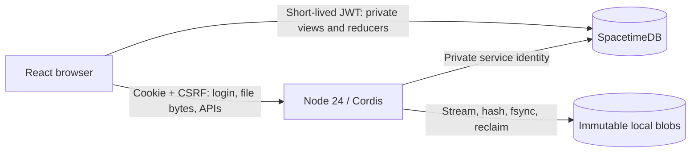

# Architecture

Authorized November 5–6, 2026 as a fresh application in `next/`, replacing the old
Node/SQLite design. Native auth and Files came first; Contacts/Calendar, the
identity provider, Notes/Tasks, installed apps and Agent were added in the same
architecture.

## Components

- **SpacetimeDB** owns structured state, identity/directory records,
  authorization, transactional domain changes and bounded subscriptions.
- **Node 24 / Cordis** owns login, credential checks, token issuance, blob
  transfers, DAV, OIDC/SCIM, reminders, backups and Agent runs. Every effect is
  owned by a Cordis context and disposed deterministically.
- **Local disk** holds immutable opaque-keyed blobs, temporary uploads and
  protected keys. No SQLite, search server, ORM, broker or object store.
- A reverse proxy terminates HTTPS. Unknown non-empty roots and symlinked managed
  storage fail closed.

## Identity

- Native setup (single transaction with an operator bootstrap key), login,
  logout, password change, sessions, suspension and operator password recovery.
  No public registration or external identity provider.
- Immutable user IDs are separate from usernames, display names and email.
  Credential and session tables are reachable only by the service identity.
- Passwords: async scrypt (N=2^17, r=8, p=1), random salt, bounded concurrency,
  constant-time comparison, at least 15 characters, no trimming or truncation.
  Login failures do not reveal accounts and are rate limited.
- Browser sessions use an opaque Secure, HttpOnly, SameSite=Strict cookie (digest
  stored), CSRF and exact-origin checks. The configured origin is authoritative.
- The browser exchanges its session for a short-lived SpacetimeDB token from the
  internal `/auth/issuer` (audience `dar-browser`, subject = session + per-tab
  UUID). Views and reducers check the live session, so logout, password change,
  suspension and expiry revoke access without waiting for token expiry.
- Signing keys use an AES-GCM keyring with private file permissions (the
  colocated master key is operator trust, not protection from host compromise).
- Dar is also an OIDC provider and SCIM server; see [identity](identity-provider.md).

## Files

- Private tables: entries (opaque ID, owner, parent, name, kind, current version,
  revision, trash), versions (immutable blob, size, digest, media type), uploads,
  grants, public shares, favorites, backup pins, usage, root revisions, activity.
- Folders are records; rename and move never touch blobs. Reducers check names,
  duplicates, cycles, grants, quotas and expected revisions. Lists use opaque
  cursors and never carry file content.
- **Upload:** reserve → stream to a private temp file within limits → hash, fsync,
  finalize without overwriting, fsync the directory → a service call verifies the
  reservation, authorization, revision, size, digest and quota → commit version,
  revision and activity together. Retries return the same result.
- Old versions keep their blobs; trash keeps references; permanent deletion marks
  content reclaimable. Cleanup claims expired uploads transactionally, respects
  live versions and backup pins, and acknowledges deletions idempotently.
- Downloads go through the runtime with current permission checks, safe
  Content-Disposition, range/HEAD and attachment-only active content. Public links
  are hashed capability URLs with expiry and revocation.

## Client

React/TypeScript with self-hosted CSS, fonts and SVG icons; UI rules are in the
[design guide](../design.md). The pinned SpacetimeDB SDK builds codecs with
`Function()`, so the CSP needs `script-src 'self' 'unsafe-eval'`; inline scripts
stay forbidden. Offline editing and full-text content search are out of scope;
disconnection is shown honestly and reconnects refetch safely.

## Backups and upgrades

Backups (format v6, reading v1–v5) snapshot database state and referenced blobs
with pins; restore needs an empty root and invalidates sessions and bearer
credentials. Schema changes are additive numbered migrations tested against
older databases. Verification: `npm --prefix next run verify` (typechecks,
integration, browser, DAV client, backup/restore and forced crash/restart). These
are fixture proofs, not production capacity guarantees.

## References

[SpacetimeDB authentication](https://spacetimedb.com/docs/core-concepts/authentication/) ·
[access permissions](https://spacetimedb.com/docs/tables/access-permissions/) ·
[migrations](https://spacetimedb.com/docs/databases/automatic-migrations/) ·
[OWASP password storage](https://cheatsheetseries.owasp.org/cheatsheets/Password_Storage_Cheat_Sheet.html)
