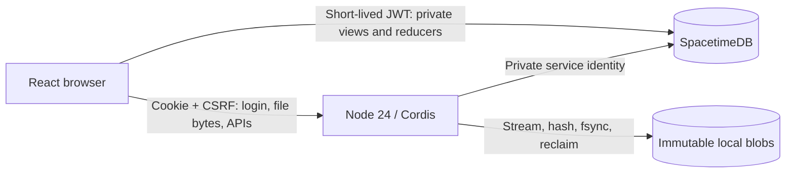

# Architecture

Authorized November 5–6, 2026 as a fresh application in `next/`, replacing the old
Node/SQLite design. Native auth and Files came first; Contacts/Calendar, the
identity provider, Notes/Tasks, installed apps and Agent were added in the same
architecture.

## Components

- **SpacetimeDB** owns structured state, identity/directory records,
  authorization, transactional domain changes and bounded subscriptions.
- **Node 24 / Cordis** owns login, credential checks, token issuance, blob
  transfers, DAV, OIDC/SCIM, reminders, backups, News feed fetching and Agent runs. Every effect is
  owned by a Cordis context and disposed deterministically.
- **Local disk** holds immutable blobs named by the SHA-256 of their content, temporary uploads and
  protected keys. No SQLite, search server, ORM, broker or object store.
- A reverse proxy terminates HTTPS. Unknown non-empty roots and symlinked managed
  storage fail closed.
- Node service calls that change state wait until SpacetimeDB has made them
  durable (`db.call`). Calls that only read (`db.read`, the sets in
  `shared/read-operations.ts`) skip that wait, about 10 ms each; a read may then
  show a change made milliseconds earlier that a power loss could still undo.

## Identity

- Native setup (single transaction with an operator bootstrap key), login,
  logout, password change, sessions, suspension and operator password recovery.
  No public registration or external identity provider.
- Immutable user IDs are separate from usernames, display names and email.
  Credential and session tables are reachable only by the service identity.
- Passwords: async scrypt (N=2^17, r=8, p=1), random salt, bounded concurrency,
  constant-time comparison, at least 15 characters, no trimming or truncation.
  Login failures do not reveal accounts and are rate limited.
- Browser sessions use an opaque Secure, HttpOnly, SameSite=Strict cookie (digest
  stored), CSRF and exact-origin checks. The configured origin is authoritative.
- The browser exchanges its session for a short-lived SpacetimeDB token from the
  internal `/auth/issuer` (audience `dar-browser`, subject = session + per-tab
  UUID). Views and reducers check the live session, so logout, password change,
  suspension and expiry revoke access without waiting for token expiry.
- Signing keys use an AES-GCM keyring with private file permissions (the
  colocated master key is operator trust, not protection from host compromise).
- Dar is also an OIDC provider and SCIM server; see [identity](identity-provider.md).

## Files

- Private tables: entries (opaque ID, owner, parent, name, kind, current version,
  revision, trash), versions (blob, size, media type), blobs (digest, size, state,
  next check), uploads (transfers, kept an hour), grants, public shares, favorites,
  backup pins, usage, root revisions, activity.
- Folders are records; rename and move never touch blobs. Reducers check names,
  duplicates, cycles, grants, quotas and expected revisions. Lists use opaque
  cursors and never carry file content.
- **Content addressing** (maintainer decision, November 17, 2026): a blob's name is
  its SHA-256, so identical content is stored once across files, versions, accounts,
  Photos and Git. Quotas still count each version's full size. Blob names reach only
  people who can read the content.
- **Upload:** reserve → stream to a private temp file within limits → hash, fsync →
  link under the digest and fsync the directory, or keep identical content already
  stored and mark it used now → a service call verifies the reservation,
  authorization, revision, size, digest and quota → commit version, blob record,
  revision and activity together. Retries return the same result. A Git push stores its
  files as one batch (`receiveBatch`): written in turn, flushed together, then linked
  under their digests.
- Request bodies (uploads, WebDAV writes, Git pushes) have no total time limit: one is
  dropped after a minute without new bytes, below 16 KiB a minute, or after 6 hours.
  Headers must arrive within 15 seconds.
- Old versions keep their blobs; trash keeps references. Removing a version or pin
  schedules a check of its blob; new blobs are checked after a two-hour grace.
  Maintenance claims blobs no version, backup pin or Chat attachment uses, the runtime removes only
  content nothing linked or reused within the grace, and acknowledgement deletes
  only blobs still claimed (an upload may have reused one). A daily sweep removes
  content an upload stored but never recorded.
- **Migration:** content stored by upload ID (before content addressing) is renamed
  at startup, before anything is served: hard links give each blob its digest name,
  one transaction switches every reference, then the upload-ID names go (Photos
  and Books caches follow). Each step repeats safely after a crash; startup stops
  if referenced content is missing.
- WebDAV (`/dav/files/<username>/`) uses the same checked operations; `If-Match` is
  optional (a replaced file keeps its versions), locks are advisory and clients may set
  modified times, which renames and moves keep. A runtime worker records each blob's SHA-1
  and MD5 (blob checksums) for sync clients that compare only those; Dar never names or
  trusts content by them. See [WebDAV](../webdav.md).
- Downloads go through the runtime with current permission checks, safe
  Content-Disposition, range/HEAD and attachment-only active content. Public links
  are hashed capability URLs with expiry and revocation.
- Folder history: repos, changesets, changes, head trees and branches reference
  versions, so history adds no bytes; permanent deletion keeps versions history
  uses. Git clients clone, fetch and push tracked folders at `/dav/git/<folderId>.git`
  (or the alias `/dav/git/<username>/<path>.git`) with an app password; the runtime
  keeps a rebuildable bare repository per folder under `<root>/git`. The Git app reads
  those caches through `/api/v1/git`. See [folder history](folder-history.md) and
  [Git](../git.md).

## Client

React/TypeScript with self-hosted CSS, fonts and SVG icons; UI rules are in the
[design guide](../design.md). The pinned SpacetimeDB SDK builds codecs with
`Function()`, so the CSP needs `script-src 'self' 'unsafe-eval'`; inline scripts
stay forbidden. Offline editing and full-text content search are out of scope;
disconnection is shown honestly and reconnects refetch safely.

Built-in and installed apps open in place (`client/navigation.ts`): each app
mounts afresh as after a page load, and a page with unsaved changes falls back to
a normal load so the browser still warns. Installed apps are disposed through the
cleanup their `mount` returns. Shared links and sign-in pages always load normally. Files, Contacts, Calendar, Notes and Tasks share one live
connection per page (`client/live.ts`), kept a minute after the last of them closes.

## Backups and upgrades

Backups (format v11, content named by digest; reading v1–v10, whose upload-ID names the
next start migrates) snapshot database state and referenced blobs
with pins; restore needs an empty root and invalidates sessions and bearer
credentials. Schema changes are additive numbered migrations tested against
older databases. Verification: `npm --prefix next run verify` (typechecks,
integration, browser, DAV client, backup/restore and forced crash/restart). These
are fixture proofs, not production capacity guarantees.

## References

[SpacetimeDB authentication](https://spacetimedb.com/docs/core-concepts/authentication/) ·
[access permissions](https://spacetimedb.com/docs/tables/access-permissions/) ·
[migrations](https://spacetimedb.com/docs/databases/automatic-migrations/) ·
[OWASP password storage](https://cheatsheetseries.owasp.org/cheatsheets/Password_Storage_Cheat_Sheet.html)
