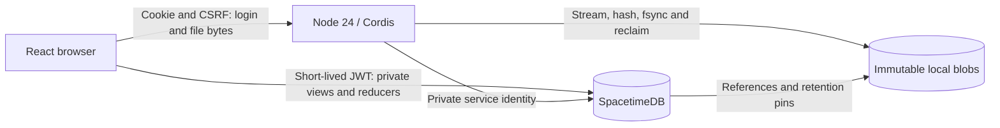

# SpacetimeDB architecture and auth / Files delivery plan

Status: native auth and Files implemented; real-database, browser, restore and
crash/restart acceptance passed on November 6, 2026. See `next/README.md` for use
and explicit interoperability/capacity limits.
Branch: `codex/spacetimedb-auth-files`.

The November 6 extension adds Contacts and Calendar in the same architecture;
see [their delivery contract](contacts-calendar.md). The original milestone below
records the auth/Files foundation, not a restriction on that subsequent approval.

## Authority and scope

The maintainer requested this fresh architecture in the November 5, 2026
conversation, then authorized a new branch and implementation of **only native
authentication and Files**. This is an explicit replacement of the old single
Node/SQLite/portable-authoritative-data architecture for this branch's new
application. It authorizes SpacetimeDB and its SDK, a React/TypeScript client,
and a Node 24/Cordis integration runtime. It does not authorize modifying live
storage, migrating existing users, deleting unrelated work, or adding other apps.

Existing uncommitted work is preserved. The new application lives under `next/`,
with independent `dev`, `serve`, `operator` and `verify` entry points. Existing
root entry points are left intact because they include unrelated local work.
No old runtime is needed by the new app, and there is no SQLite fallback. Moving
this application to the repository root is a subsequent repository cleanup,
not a runtime compatibility requirement.

Nextcloud-style light Material 3, self-hosted assets, and persistent centered
search remain the approved visual direction. The maintainer selected **C —
Focused explorer** from `auth-files-mocks.html`: compact rows, persistent desktop
details, focused mobile panels, and native sign-in. UI implementation is authorized.

## Deployment and responsibilities

- A reverse proxy terminates HTTPS and routes same-origin requests to SpacetimeDB
  and the Cordis runtime, which serves the local static React bundle.
- One SpacetimeDB database owns structured state, identity/directory records,
  authorization, transactional domain changes, and bounded subscriptions.
- One Node 24/Cordis runtime owns native login, credential verification, token
  issuance, blob transfers, reconciliation, exports, and external work.
- Local disk holds immutable opaque-keyed blobs, temporary uploads, and protected
  signing keys. Database persistence is separate. No SQLite or search server.
- Every test uses an isolated database, storage root, signing keys, and browser
  profile. Unknown non-empty roots and symlinked managed storage fail closed.

SpacetimeDB owns application decisions; Cordis executes authorized effects.
No duplicate permission engine, generic repository layer, message broker, ORM,
microservice fleet, runtime CDN, or standalone object-storage server is needed.

The final arrow is a logical reference, not database access to the filesystem.
The runtime's durable upload records bridge that boundary. Metadata commits never
pretend to make a filesystem write atomic.

## Native identity now; OIDC and SCIM later

The application handles authentication itself; there is no external identity
provider dependency. Cordis owns first-administrator setup, login, logout,
password changes, account administration, recovery, and session management.

Persist immutable user IDs separately from usernames, display names, and email.
Private tables hold accounts, credential verifiers, hashed session secrets,
session expiry/revocation and scoped app-password digests. Credentials
are accessible only to the identity service's narrow service identity. Browser
users and ordinary workers cannot query credential/session tables.

Use Node's asynchronous scrypt with a random salt and OWASP's N=2^17, r=8, p=1
baseline, bounded hashing concurrency, and constant-time verifier comparison.
Use at least 15 characters for new password-only credentials, accept spaces and
Unicode without trimming or silently truncating, and impose a generous byte
limit to bound abuse. Store algorithm/version parameters for future upgrades.
Login failures must not disclose account existence; limit attempts and request
sizes before expensive hashing. Never log credentials, tokens, or session IDs.

Browser login creates an opaque Secure, HttpOnly, SameSite cookie. Store its
digest, not its secret. Cookie writes require CSRF and exact configured-origin
checks. The runtime ignores forwarded identity/origin headers. First setup is a
single transaction and requires an operator bootstrap secret. Public registration
is disabled. Recovery uses an explicit operator password-file flow, without
depending on a future Email app or implementing an unused recovery-token system.

Direct browser SpacetimeDB connections need a compatible signed identity token.
The native identity service exchanges an active cookie session for a short-lived
connection token, held in browser memory. Implement only the issuer/discovery/
public-key surface required for this integration initially. This is not yet a
general third-party OIDC provider. Use a maintained JOSE implementation rather
than inventing JWT validation. Pin issuer and audience in the module, reject
anonymous and unrelated identities, validate expiry, and preserve stable subject
mapping. Signing keys use an AES-GCM keyring and private OS file permissions.
The colocated master key is operator trust, not protection from a compromised
host. Automated signing-key rotation is future work.

Connection subjects combine the cookie session ID with a per-tab UUID. Principal
records bind them to live sessions, while navigation belongs to the tab identity.
Views depend on live session/account state; a scheduled expiry invalidates already
connected views as well as rejecting subsequent writes. Logout, password change,
operator recovery and suspension revoke access without waiting for JWT expiry.

**First integration gate:** prove password login to a real SpacetimeDB instance,
issuer/key discovery, reconnect, and revocation before building the Files UI.
Password changes, logout, recovery, account suspension, and revoked sessions must
remove write access and ongoing subscription access. JWT expiry alone is not
proof of revocation. Bind subscriptions to live session state using verified
runtime capabilities; if the SDK cannot support the proposed direct-connection
policy, document and resolve the transport design before proceeding. Do not
silently ship stale authorized connections or substitute permanent host tokens.

Eventually expose OIDC authorization-code/PKCE, registered clients, consent,
discovery, token/UserInfo endpoints, and key rotation over the same directory.
SCIM service endpoints manage that directory; outbound SCIM provisioning is a
separate optional worker capability. Neither future feature is implemented now.

## Files data model

Private tables, indexed by explicit user/scope and collection identity:

- `fileEntries`: opaque ID, owner, parent ID, normalized display name, kind,
  current version, revision, timestamps, trash state, original parent.
- `fileVersions`: file ID, immutable blob ID, verified size/digest, media type,
  author, revision metadata, creation time.
- `uploads`: owner/session, target, expected revision, reservation, limits,
  state, expiry and blob digest. The upload ID is the immutable blob key and
  completion operation ID; version references and upload records are sufficient
  for reclamation without a second blob registry.
- `fileGrants`, `publicShares`, `favorites`: scoped access and saved state.
- `backupPins`, `usage`, `rootRevisions`, `activity`: retention, quotas, conditional
  folder mutations and domain events. Upload records are the durable work queue;
  there is no generic jobs framework or separate Activity/Notifications app.

Folders are database records. Rename/move never rename physical blobs. Validate
names, duplicate siblings, ancestor cycles, grants, quotas, and expected revisions
in domain reducers. Use opaque cursor pagination with a deterministic tie-breaker.
File content is never included in ordinary list subscriptions.

## Blob and mutation lifecycle

1. Authorize and reserve an upload transactionally; allocate an opaque key.
2. Stream into a private temporary file with configured size and capacity limits.
3. Hash bytes, fsync the file, atomically finalize without overwriting an existing
   blob, and fsync the directory. Reject symlink traversal centrally.
4. Finalize with a narrow service call which verifies the pending operation,
   current authorization, expected file revision, size, digest, and quota.
5. Commit file/version references, revision, and activity together. Repeated
   completion returns the same result. Only then expose the completed version.

Interrupted work has a durable recognizable state. New versions preserve old
blobs. Restore creates a new current version referencing retained content.
Trash retains references; permanent deletion marks reclaimable content. Cleanup
protects active uploads, live versions, and every retained backup manifest.
Cleanup claims expired uploads transactionally, checks versions and backup pins,
unlinks/fsyncs bytes and acknowledges deletion repeatably. Bound
concurrency and drain or cancel owned tasks on disposal; callbacks are wakeups,
not the durable job queue. Never promise exactly-once external effects.

Downloads pass through the authenticated runtime with current permission checks,
safe Content-Disposition, range/HEAD support, and content-type isolation for
untrusted active files. Public links have their own narrowly scoped authorization,
expiry and revocation. Public links are capability URLs; their secrets are hashed
in the database. Password policies and public folder browsing are deferred. Do
not expose service/session credentials or log public-link tokens. Existing
authorized download streams may finish after revocation.

## Client and visual design

Use React/TypeScript with self-hosted CSS, sans-serif fonts, and SVG icons.
The pinned SpacetimeDB SDK creates binary codecs using `Function()` and therefore
currently needs CSP `script-src 'self' 'unsafe-eval'`. Inline scripts remain
forbidden, React escapes user text, and untrusted active files are attachment-only.
Removing this exception requires SDK support or build-time codecs; do not claim
strict no-eval CSP compliance for this SDK version.
Keep the Nextcloud composition: global top bar with centered persistent search,
Files sidebar, bounded folder list/grid, and optional details panel. Material 3
tonal surfaces, rounded controls, blue actions, visible keyboard focus, and touch
targets. Small screens show one focused panel with accessible navigation.

Auth: setup, sign-in, recovery, change password, sessions, and sign-out.
Files: upload/drop queue, folders, breadcrumbs, list/grid, sorting, selection,
rename, move/copy, download, preview, details, favorites, versions, trash/restore,
permanent deletion, user sharing, and public-link visitor flow. No dead controls,
placeholder actions, browser-native dialogs, or non-functional navigation.
Disabled/unavailable features are explicit, not implied as working.

Retain keyboard navigation, focus restoration, accessible names and live regions.
Loading, empty, denied, conflict, network-error, upload-cancellation and expired-
session states must work. Offline editing is out of scope; show disconnection
honestly and reconnect/refetch safely. Advanced full-text/content search is out
of scope; initial name search and structured filters are explicit and bounded.

## Delivery sequence and acceptance

1. Branch, architecture, static mocks, and explicit visual selection.
2. Isolated runtime/package and real SpacetimeDB module; native identity vertical
   slice with persisted setup/login, signed connection, logout/revocation.
3. Private Files schema/reducers/views and immutable storage lifecycle; focused
   service/process tests before UI integration.
4. Selected auth and Files React UI backed by real state, not in-memory fixtures.
5. Sharing, versions, recovery, export/backup and scoped Files WebDAV/app-password
   interoperability. No legacy protocol aliases. APIs use documented camelCase
   envelopes and revision-backed conditional writes where HTTP applies.
6. Integrated browser, protocol, restart, interruption, authorization, and restore
   verification; update the matrix below with reproducible commands and evidence.
7. Deliver the independently runnable `next/` application and operator runbook.
   Repository-root consolidation can follow when unrelated local work is ready;
   do not delete it as part of this milestone.

| Surface | Required proof | Status |
| --- | --- | --- |
| Identity primitives | Salted hashing, malformed verifiers, token digests, CSRF/origin rejection | Pass: primitive, keyring and HTTP security tests |
| Setup and native login | Competing setup, persisted credentials, login limits, operator recovery | Pass: native integration, HTTP security and restart tests |
| Live authorization | Private tables; user isolation; audience rejection; live logout, password, suspension and expiry revocation | Pass: auth/security and Files integration tests |
| File persistence | Byte identity, empty/Unicode files, range/HEAD, restart, duplicate completion | Pass: Files, DAV and restart tests; no 1 GiB boundary throughput claim |
| File operations | Folder cycles, collisions, concurrent revisions, move/copy, favorites, versions | Pass: Files integration, pagination and browser journey |
| Reverse operations | Trash/restore, conflicts, permanent removal, safe reclamation | Pass: Files and GC integration tests |
| Sharing/protocol | User grants/revocation, public-link revocation, scoped DAV app passwords | Pass for documented DAV subset; no full client-conformance claim |
| Crash recovery | Interrupt transfer, restart database/runtime, recover stale lock/temp, retry finalization | Pass: forced-failure restart journey; GC separately proves repeatable claim/delete/ack |
| Backup/export | Consistent snapshot, pins, corruption rejection, empty-root restore and bytes | Pass: backup/export and GC integration tests |
| UI | Desktop and phone, focus restoration, console, real server writes | Pass: Chromium at 1440×950 and 390×844, including pending-upload cancellation and reconnect during navigation |
| Capacity/lifecycle | Indexed bounded windows, shutdown ownership, observed memory | Pass for 250-entry fixture; larger archive sizing remains unmeasured |

Reproduce with `nix develop ./next`, `npm ci --prefix next`, then
`npm --prefix next run verify`. The command runs both TypeScript checks, 18 Node
tests against isolated state, the browser journey, and the forced restart journey.
On November 6 the indexed fixture took 296 ms (creation plus query/collision work)
and database process-tree RSS was 289 MiB, including auxiliary restore/GC databases.
These are local fixture measurements, not latency, memory or production capacity
guarantees. Verification artifacts remain outside the repository.

Two persistence issues found during acceptance are addressed in the initial
schema: activity IDs survive restore without auto-increment sequence repair, and
module-generated UUIDs check retained IDs because this SDK seeds reducer randomness
from timestamps. Concurrent transactions with equal timestamps can otherwise
produce the same initial UUID.

A separate fresh-root production-launcher check restored the completed backup,
verified file digests, Secure cookies, HSTS and the public database URL. It used
loopback transport with an HTTPS configured origin; external TLS proxy deployment
and ARM64 execution have not been tested in this environment.

“100% working” means this milestone's acceptance matrix passes, not a claim of
bug-free software or full Nextcloud feature parity. Do not mark complete based
on screenshots, mocked SDK calls, or passing auth primitive tests alone.

## References

- [SpacetimeDB authentication](https://spacetimedb.com/docs/core-concepts/authentication/)
- [Issuer/audience checks](https://spacetimedb.com/docs/core-concepts/authentication/usage/)
- [Private tables and views](https://spacetimedb.com/docs/tables/access-permissions/)
- [Pagination](https://spacetimedb.com/docs/how-to/app-patterns/pagination/)
- [Immutable external-content upload pattern](https://spacetimedb.com/docs/how-to/app-patterns/store-files-in-s3/)
- [Schema migrations](https://spacetimedb.com/docs/databases/automatic-migrations/)
- [OWASP password storage](https://cheatsheetseries.owasp.org/cheatsheets/Password_Storage_Cheat_Sheet.html)
- [OIDC Core](https://openid.net/specs/openid-connect-core-1_0.html)
- [SCIM protocol](https://www.rfc-editor.org/info/rfc7644/)
